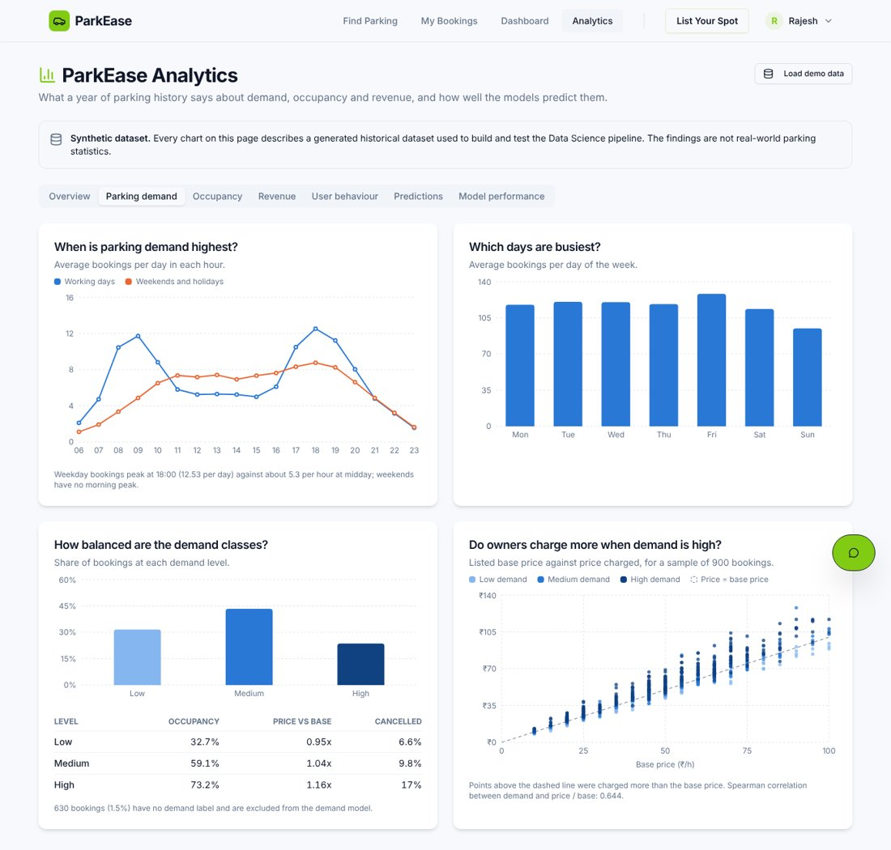
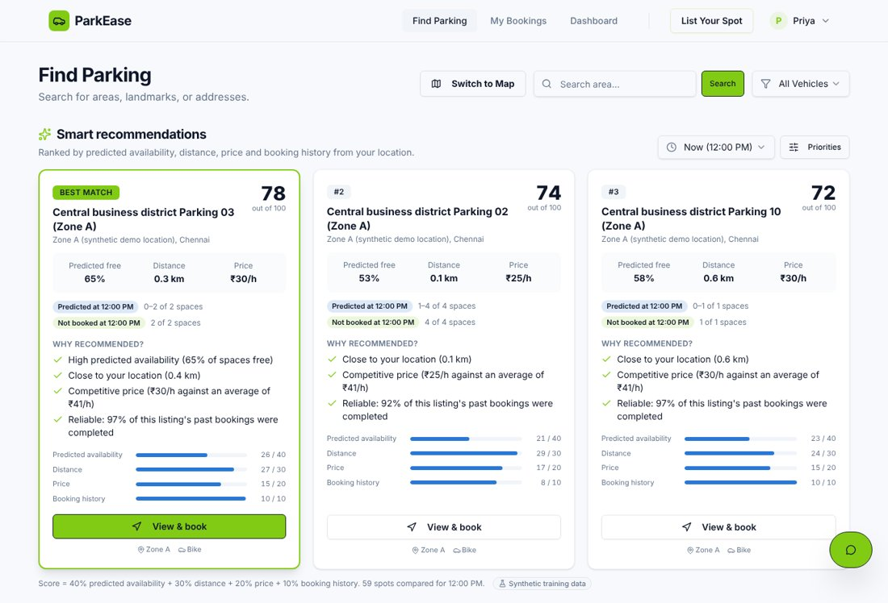
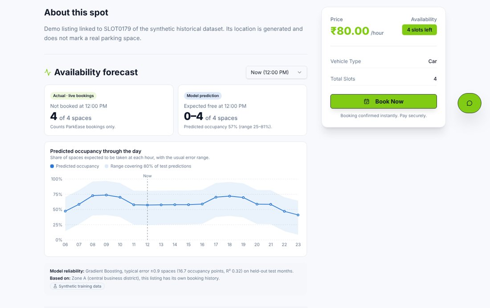
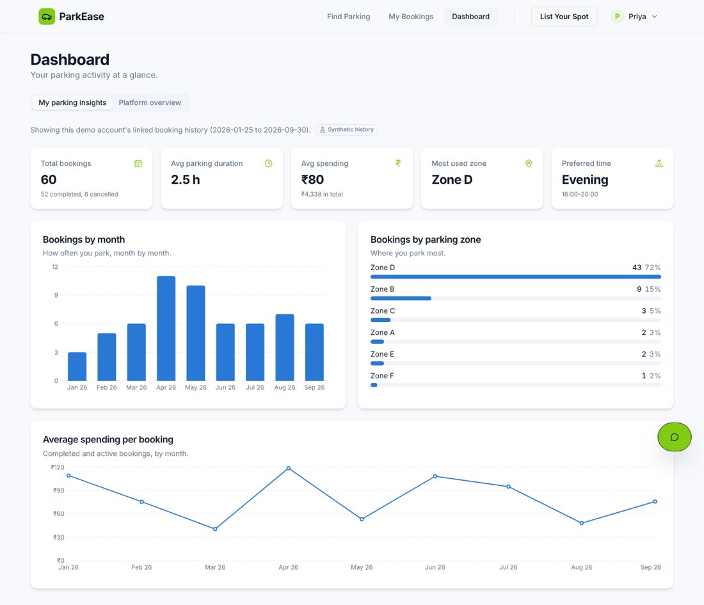
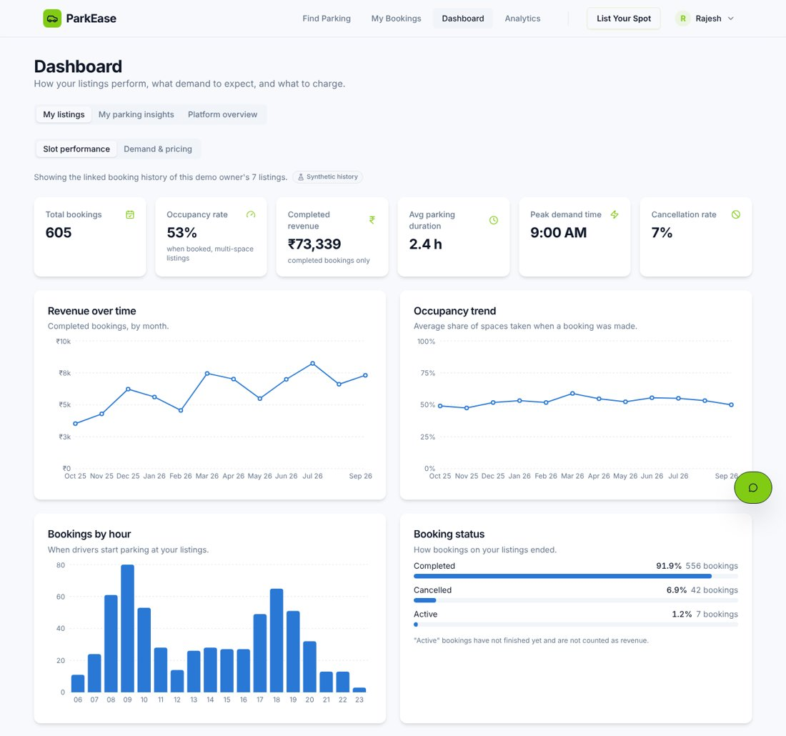
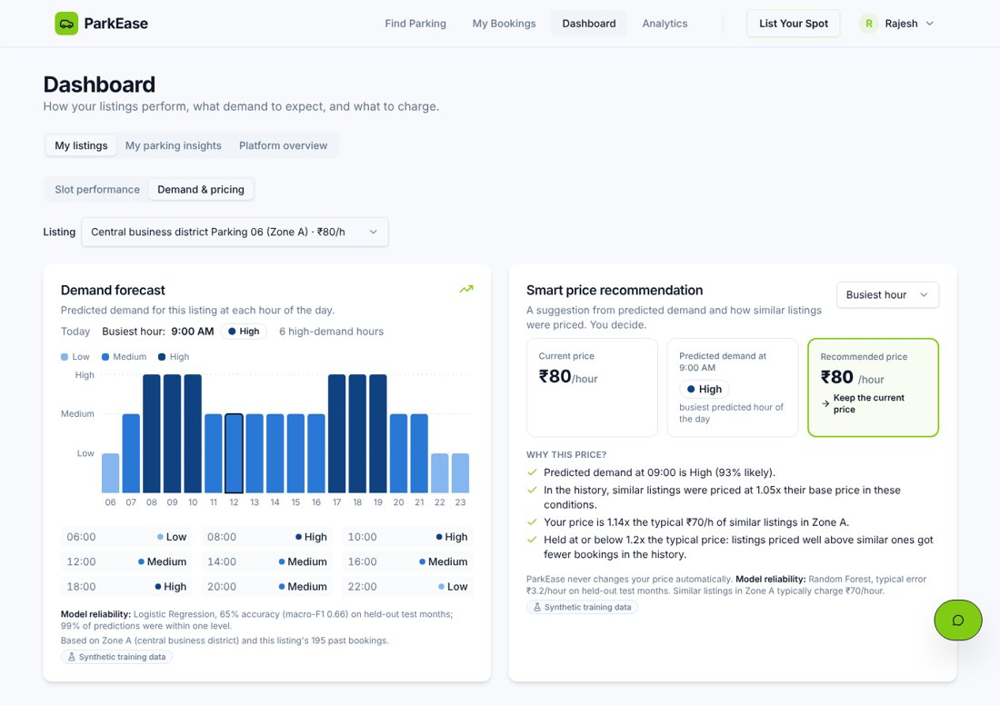

# Summary

ParkEase now uses a year of historical parking data to help drivers choose a spot and to help owners understand demand and set prices. Three features were added for each role, plus an analytics dashboard, without removing any existing feature.

- **Data.** The supplied dataset (1,800 users, 500 listings, 42,378 bookings) passes all 42 validation checks. It is **synthetic**: every figure in this report describes generated data, not real parking behaviour.
- **Models.** Three models were trained and tested on months they had not seen. All three beat their baselines, by modest margins: the dataset contains a lot of deliberate noise, and the scores below are reported as measured.
- **Integration.** Predictions are computed by a Python service and reach the app through the existing API server. When the service is off, the app shows a clear "unavailable" state instead of numbers.
- **Roles.** Driver, owner and admin are now real roles: sign-in checks a password, and the server decides what each role may do.
- **Testing.** 35 automated tests, 189 end-to-end API checks, 113 browser checks (including phone-sized pages) and 38 payment checks pass. The full typecheck, which failed before the work started, now passes.

| Model | Chosen algorithm | Test result | Baseline |
|---|---|---|---|
| Availability (occupancy %) | Gradient Boosting | MAE 16.7 points, R² 0.32, about ±0.9 spaces | MAE 20.1 (slot average) |
| Demand (Low / Medium / High) | Logistic Regression | Accuracy 64.9%, macro-F1 0.66 | Accuracy 44.0% (always Medium) |
| Price response (price ÷ base price) | Random Forest | MAE ₹2.54/h; ₹3.24/h as used in the app | MAE ₹3.63/h (keep base price) |

# 1. Existing project analysis

ParkEase is a pnpm monorepo exported from Replit.

| Layer | What was there |
|---|---|
| Frontend | React 19, Vite 7, Tailwind 4, shadcn/ui, wouter, TanStack Query, Recharts, Google Maps |
| Backend | Node, Express 5, Drizzle ORM, PostgreSQL |
| API contract | OpenAPI file that generates validators and React hooks with Orval |
| Database | `users`, `spots`, `bookings`, `reviews`, with no foreign keys |
| Auth | Mock login kept in the browser's local storage; no server session |

**Worked:** spot search with a 500 m radius, map view, spot pages and reviews, booking with a capacity-aware overlap check, cancellation, automatic completion of expired bookings, listing a spot, a platform dashboard.

**Problems found in the audit:**

| Problem | Status |
|---|---|
| My Bookings, Profile and List Spot were hardcoded to user 1 | Fixed |
| "Spots left" was never reduced when a booking was made | Fixed: computed from live bookings |
| Demo login used hardcoded user IDs that might not exist | Fixed: resolved by email on the server |
| Typecheck failed (7 errors in `lib/api-zod`, 4 in the frontend) | Fixed |
| Dashboard chart labelled "monthly" showed all-time revenue | Label corrected |
| Login did not check a password; roles were not enforced on the server | Fixed: real sign-in and server-side permissions (section 10) |
| Any owner could deactivate or delete any spot | Fixed: only the spot's owner or an admin |
| Sign-up could only create drivers; admin had no admin functions | Fixed: sign-up as driver or owner; admin console added |
| Listing a spot failed when the day price was left empty | Fixed |
| Payment is simulated; "Pay Now" does nothing | Left as is |
| `.env` files, a Google Maps key and a database password are committed | Left as is; rotate them before publishing the code |

# 2. Changes made

## New

| Path | Purpose |
|---|---|
| `data/raw/` | The three supplied CSV files, unmodified |
| `data/docs/` | Data dictionary and dataset README |
| `data/reports/` | Validation report, EDA summary, nine EDA figures |
| `ml/config.py` | Paths, schema, allowed values, split dates, weights, rules, seed |
| `ml/preprocessing/` | Loading, validation, cleaning, feature engineering, demo links |
| `ml/eda/` | Reusable analytics functions and the offline figures |
| `ml/training/` | Training scripts for the three models and `train_all` |
| `ml/evaluation/` | Metrics and permutation feature importance |
| `ml/prediction/` | Prediction, price rules and recommendation scoring |
| `ml/service/` | FastAPI service |
| `ml/tests/` | 35 automated tests and the end-to-end check scripts |
| `models/` | Trained models and `metrics.json` (created by training) |
| `backend/src/routes/datascience.ts` | The new API routes |
| `backend/src/routes/auth.ts`, `admin.ts`, `lib/auth.ts` | Sign-in, sign-up, tokens, permission checks, admin console routes |
| `frontend/src/pages/admin/`, `lib/auth-api.ts` | Admin console page and the sign-in client |
| `backend/src/lib/` | `mlClient`, `liveAvailability`, `localTime`, `dsSchema` |
| `frontend/src/lib/ds-api.ts` | Typed client and hooks for the new routes |
| `frontend/src/components/ds/` | Recommendation, forecast, analytics and pricing components |
| `frontend/src/pages/analytics/` | The Data Science dashboard |
| `docs/` | This report, `HOW_TO_RUN.md`, screenshots |

## Existing files changed

| File | Change |
|---|---|
| `backend/src/index.ts`, `routes/index.ts` | Mount the new routes; add two optional columns at start-up |
| `backend/src/routes/spots.ts` | `availableSlots` now comes from live bookings |
| `lib/db/src/schema/users.ts`, `spots.ts` | Optional `datasetUserId` and `datasetSlotId` |
| `lib/api-zod/src/index.ts` | Removed the duplicate export that broke the typecheck |
| `frontend/src/App.tsx`, `Navbar.tsx` | `/analytics` route; Analytics link for owners and admins |
| `frontend/src/pages/dashboard/index.tsx` | Role-aware tabs; the original dashboard is kept as "Platform overview" for admins |
| `backend/src/routes/users.ts`, `bookings.ts`, `reviews.ts`, `dashboard.ts` | Permission checks; bookings and reviews are recorded under the signed-in user |
| `frontend/src/context/AuthContext.tsx`, `pages/auth/login.tsx` | Token-based session; password sign-in; sign-up as driver or owner |
| `frontend/src/pages/spots/index.tsx`, `spots/detail.tsx` | Recommendation panel; availability forecast |
| `frontend/src/pages/bookings`, `profile`, `list-spot`, `auth/login` | Use the logged-in user instead of user 1 |
| `frontend/src/index.css`, `components/ui/slider.tsx` | Chart colour tokens; slider label for screen readers |
| `.gitignore` | Ignore generated models and processed data |

No dependency was added to the Node packages, so the lockfile is unchanged.

# 3. Data Science architecture

```
Historical CSVs (synthetic)          Live ParkEase database
        │                                     │
        ▼                                     │
load → validate → clean → features            │
        │                                     │
        ├── EDA summary and figures           │
        ▼                                     │
train → evaluate → saved models               │
        │                                     │
        ▼                                     ▼
 Data Science service  ◄────────────  Express API server
 (FastAPI, port 8000)   spots, bookings   (/api/analytics,
        │                                  /api/predictions,
        └──── predictions, analytics ───►  /api/recommendations)
                                               │
                                               ▼
                                        ParkEase web app
```

- **Separate training and prediction.** `python -m ml.training.train_all` runs the pipeline once and saves the models. The service only loads them.
- **Historical and live data stay apart.** The CSVs are never loaded into the live tables. The API server reads live spots and bookings and sends them to the service with each request.
- **Reproducible.** One fixed seed (42); the same data gives the same models and the same demo links.

**Linking live data to the history.** A live spot is described to the models in one of three ways, and the app says which one was used:

| Case | How the zone and history are chosen |
|---|---|
| Demo spot linked to a historical listing | That listing's own zone and booking history |
| Spot within 8 km of a zone centre | Nearest zone; history of similar listings in that zone |
| Spot elsewhere (another city) | Zone with the most similar typical price; flagged as a weaker match |

# 4. Dataset

| File | Rows | Content |
|---|---|---|
| `users.csv` | 1,800 | 1,500 drivers and 300 owners, with registration date and vehicle type |
| `parking_slots.csv` | 500 | Listings: owner, zone, coordinates, capacity, base price, vehicle type, active flag |
| `parking_bookings.csv` | 42,378 | One year of bookings (1 Oct 2025 to 30 Sep 2026) with time, occupancy snapshot, duration, price, amount, distance, status and demand level |

Owners have listings, listings have bookings, and each booking belongs to one driver.

**Validation.** 42 checks in eight groups (keys, relationships, dates, occupancy arithmetic, price and duration, categories, geography, behaviour rules) all pass with 0 violations. The validator was also tested on 13 deliberately corrupted copies and caught each fault.

# 5. Data preprocessing

## Missing values

No row was deleted. Every filled value is flagged in an `_imputed` column.

| Column | Missing | Handling |
|---|---|---|
| `occupancy_rate` | 636 | Exact: occupied slots ÷ capacity × 100 |
| `booking_duration_hours` | 509 | Exact: amount ÷ price |
| `price_per_hour` | 424 | Exact: amount ÷ duration |
| `distance_km` | 848 | Median of the same zone, learned from the training months only |
| `demand_level` | 636 | 6 copied from another booking in the same slot and hour; **630 left missing** |
| `preferred_vehicle_type` | 36 | Inferred from the listings the user booked or owns |
| `vehicle_type_supported` | 10 | Inferred from the vehicles of drivers who booked the listing |

- **Demand is not guessed.** It is the target of the demand model, so the 630 unlabelled rows are left out of that model rather than filled.
- **The vehicle rule was checked.** When 300 known driver vehicle types were hidden and re-inferred, 97.3% were recovered, against 48.3% for filling with the most common type. A test caught an earlier version of the rule that contradicted 11 bookings; the rule was corrected.

## Feature engineering

The modelling table has one row per slot, date and hour with at least one booking: 42,126 "slot-hours".

| Group | Features |
|---|---|
| Time | hour, day of week, weekend, holiday, weekend-or-holiday, peak hour, morning peak, evening peak |
| Listing | capacity, base price, price relative to similar listings, zone, vehicle type |
| Slot history | historical occupancy, previous-day occupancy, 7-day rolling occupancy, booking frequency, historical demand, average duration |
| Zone history | occupancy, demand and booking count for the same zone, hour and day type |

Day of month, month and week of year are computed for EDA but not given to the models: one year of data cannot separate a seasonal effect from the growth trend.

## Leakage controls

- Every history feature uses only days strictly before the row's date. A test recomputes them by brute force and confirms this.
- Occupied slots, available slots and occupancy rate are the same quantity; none is a feature of another.
- Price is not a feature of the demand model, because historical prices already reflect demand.
- Imputation statistics and all scaling and encoding are learned from training rows only.
- The split is by date, not random.

# 6. EDA

These are **synthetic-data findings**. Each sentence is generated from the computed figures.

- Weekday bookings peak at 18:00 (12.5 per day) against about 5.3 per hour at midday; weekends have no morning peak.
- Friday is the busiest day (128.1 bookings per day) and Sunday the quietest (94.7).
- Monthly bookings grew from 2,938 in October 2025 to 4,294 in September 2026.
- Zone C has the most bookings (10,636) and Zone H the fewest (1,635); Zone A earns the most completed revenue.
- Average occupancy rises with demand: 32.7% at Low, 59.1% at Medium, 73.2% at High.
- Owners charge 0.95×, 1.04× and 1.16× their base price at Low, Medium and High demand.
- Cancellations rise with distance: 7.6% within 0.5 km against 27.6% at 3 to 5 km.
- Listings priced above similar listings in their zone get fewer bookings (Spearman −0.24).

The nine required charts are in the Analytics page and as image files in `data/reports/figures`: bookings by hour, by day of week, monthly trend, occupancy by zone, demand distribution, price against demand, distance against cancellation, revenue by zone, and the correlation heatmap. The page also shows summary statistics (mean, median, standard deviation, quartiles, skew).

{width=6.2in}

# 7. Models

**Evaluation design, common to all three.** Train on 1 Oct 2025 to 30 Jun 2026, compare candidates on July 2026, refit the winner on both and score it once on August and September 2026. The deployed model is then refitted on the whole year. Feature importance is permutation importance on the test months.

## 7.1 Availability prediction

| | |
|---|---|
| Problem type | Regression |
| Target | `occupancy_rate` of a slot-hour; free spaces follow from capacity |
| Features | All 22 time, listing and history features |
| Excluded | Single-space listings, which always read 0% when booked |
| Rows | Train 28,657 · validation 3,946 · test 8,278 |

| Model (validation) | MAE | RMSE | R² |
|---|---|---|---|
| Baseline: overall mean | 21.14 | 25.08 | 0.00 |
| Baseline: zone-hour average | 17.99 | 22.21 | 0.21 |
| Baseline: slot historical average | 19.88 | 23.72 | 0.10 |
| Linear Regression | 16.68 | 21.01 | 0.30 |
| Decision Tree | 16.67 | 21.27 | 0.28 |
| Random Forest | 16.47 | 21.01 | 0.30 |
| **Gradient Boosting (chosen)** | **16.39** | **20.83** | **0.31** |

**Final test performance:** MAE 16.70 occupancy points, RMSE 21.17, R² 0.32, which is about ±0.89 parking spaces. The app shows a range that covered 80% of test predictions (−32.6 to +23.3 points around the prediction).

**Most important features:** zone-hour historical demand (63%), slot capacity (19%), zone-hour booking count (5%).

## 7.2 Demand prediction

| | |
|---|---|
| Problem type | Classification: Low, Medium, High |
| Target | `demand_level` of a slot-hour |
| Features | The same 22 features; no price and no same-hour occupancy |
| Excluded | Slot-hours with a missing demand level |
| Rows | Train 29,104 · validation 4,011 · test 8,381 |

| Model (validation) | Accuracy | Precision | Recall | F1 (macro) |
|---|---|---|---|---|
| Baseline: always Medium | 0.445 | 0.148 | 0.333 | 0.205 |
| **Logistic Regression (chosen)** | **0.657** | **0.666** | **0.663** | **0.664** |
| Decision Tree | 0.619 | 0.636 | 0.616 | 0.624 |
| Random Forest | 0.645 | 0.655 | 0.648 | 0.651 |

**Final test performance:** accuracy 64.9%, macro precision 0.66, recall 0.66, F1 0.66. 99.4% of predictions are within one level of the truth.

| Actual ↓ / Predicted → | Low | Medium | High |
|---|---|---|---|
| Low | 1,767 | 908 | 31 |
| Medium | 696 | 2,283 | 707 |
| High | 20 | 583 | 1,386 |

Class shares in the test months: Low 32.3%, Medium 44.0%, High 23.7%. The simplest model won, which suggests the relationship is close to linear in the history features.

## 7.3 Price response and the price recommendation

**Approach: hybrid** (option C of the brief). A model learns how far owners priced above or below their base price in given conditions. Explainable rules then turn that ratio into a suggestion.

| | |
|---|---|
| Problem type | Regression |
| Target | `price_ratio` = price charged ÷ base price |
| Features | Demand level, time and listing features, slot occupancy and booking frequency, zone-hour demand |
| Left out on purpose | The owner's own past prices, so the model learns the market response, not one owner's habit |

| Model (validation, ratio units) | MAE | RMSE | R² |
|---|---|---|---|
| Baseline: keep base price | 0.084 | 0.117 | −0.11 |
| Baseline: average ratio per demand level | 0.064 | 0.084 | 0.42 |
| Linear Regression | 0.065 | 0.085 | 0.41 |
| Decision Tree | 0.063 | 0.083 | 0.44 |
| **Random Forest (chosen)** | **0.058** | **0.077** | **0.51** |
| Gradient Boosting | 0.060 | 0.079 | 0.49 |

**Final test performance:**

| Setting | MAE (₹/h) | RMSE (₹/h) | R² of ratio |
|---|---|---|---|
| True demand level given | 2.54 | 3.77 | 0.48 |
| Demand predicted by Model 2, as in the app | 3.24 | 4.84 | 0.17 |
| Baseline: keep base price | 3.63 | 5.71 | n/a |

R² measured in rupees is 0.98, but that mostly reflects the base price itself, so the ratio R² is the honest figure.

**Rules applied after the model:**

- Suggestions are rounded to steps of ₹5.
- One suggestion never moves the price by more than +25% or −15%.
- No increase is suggested beyond 1.2× the typical price of similar listings, because the EDA shows such listings lose bookings.
- The owner applies or dismisses every suggestion. Prices never change automatically.

## 7.4 Smart parking recommendation

A transparent weighted score, not a trained model. It uses Model 1 as one input.

```
score = 100 × (0.40 × availability + 0.30 × distance + 0.20 × price + 0.10 × history)
```

| Component | Scaled to 0–1 as | Why this weight |
|---|---|---|
| Availability | Predicted share of free spaces | The purpose of the feature |
| Distance | 1 at the driver, 0 at 3 km | Strongest cancellation driver in the EDA |
| Price | Cheapest option 1, dearest 0 | Real but weaker effect on bookings |
| History | Best completion rate 1, worst 0 | Rates differ little, so it only breaks ties |

Spots are excluded when inactive, incompatible with the vehicle, farther than 5 km, or fully booked for that hour. The driver can change the weights in the app; a test confirms each score equals the formula.

# 8. Driver features

**1. Smart parking recommendation** (Find Parking). The top three spots with a score out of 100, predicted free share, distance, price, the reasons, and a bar per component showing how the score was built.

{width=6.2in}

**2. Availability prediction** (every spot page). The actual number of spaces not booked, from live bookings, sits beside the model's prediction and its range, each labelled. A chart shows the predicted occupancy through the day, with the model's typical error underneath.

{width=6.2in}

**3. Driver analytics** (Dashboard). Total bookings, average duration, average spending, most used zone and preferred time, with charts of bookings by month, by zone, and average spending. A new user sees an empty state.

{width=6.2in}

# 9. Owner features

**1. Demand prediction** (Dashboard, Demand & pricing; shown together with feature 3 below). Low, Medium or High for each hour of the day for a chosen listing, the busiest hour, and the model's accuracy.

**2. Slot performance analytics** (Dashboard, Slot performance). Total bookings, occupancy rate, completed revenue, average duration, peak demand time and cancellation rate, with charts of revenue over time, occupancy trend, bookings by hour and booking status, and a table per listing. Revenue counts completed bookings only.

{width=6.2in}

**3. Smart price recommendation** (same tab). Current price, predicted demand, recommended price, the reasons, and "Apply" and "Keep" buttons.

{width=6.2in}

**Where the numbers come from.** The demo driver and demo owner are linked to one driver and one owner of the historical dataset, so their dashboards show a year of synthetic history, labelled as such. Any other account is analysed from its own live bookings.

# 10. Roles and permissions

Sign-in checks a password (stored as a salted scrypt hash, never in plain text) and returns a signed token that the app sends with every request. The server reads the token and decides what the caller may do, so hiding a button is not the only protection.

Each kind of account has its own job. A driver finds and books parking. An owner lists parking and manages it. An owner account cannot book and a driver account cannot list.

| | Driver | Owner | Admin |
|---|---|---|---|
| Find Parking, recommendations, parking assistant | Yes | No | Yes |
| Book; My Bookings; cancel own bookings; review a spot | Yes | No | Yes |
| Driver dashboard (own parking insights, rewards) | Yes | No | Yes |
| List Your Spot | No | Yes | Yes |
| Edit, move, deactivate or delete a spot; change its price | No | Own spots | Any spot |
| Owner dashboard (slot performance, demand forecast, price recommendation) | No | Own spots | Any spot |
| Analytics page (EDA, model performance); load demo data | No | Yes | Yes |
| Verify Entry (check a QR entry pass) | No | Own spots | Any spot |
| See and complete bookings on a spot | No | Own spots | Any spot |
| Platform overview (all revenue, users, bookings) | No | No | Yes |
| Admin console: change any user's role, manage any listing | No | No | Yes |

- **Sign-up** offers driver or owner, asks for the password twice, and has an eye button to show what was typed. Admin cannot be chosen at sign-up; only an admin can make someone an admin.
- **Someone who both parks and lists** needs two accounts (two email addresses), or an admin can change the role.
- **Demo accounts** (one per role) sign in with the demo buttons and have no password; they cannot be taken over by setting one.
- **Accounts created before passwords existed** have none stored, so their first sign-in sets it.
- **Pages are guarded too:** a driver who types `/analytics` or `/list-spot`, or an owner who types `/spots` or `/bookings`, is sent back to the dashboard.

# 10a. Features added after the Data Science work

These are ordinary application features. They do not use the models or the synthetic dataset.

**Listing a spot: location auto-fill.** The owner places a pin by searching for the address, clicking the map, dragging the pin or using the current location. Latitude, longitude, city, state and the address are filled in from the pin (Google reverse geocoding, with the nearest major city as a fallback when Google cannot be reached). A listing cannot be saved without a pin.

**Get Directions.** The old form silently saved the map's starting point (the owner's own position, or central Mumbai) as the spot's location, so directions led there instead of to the spot. Directions now end at the spot's exact pin, a new listing must have a pin, and the owner of an existing listing can correct it with **Edit location** on the spot page. Listings made before this change keep their old pin until the owner corrects it.

**Parking assistant.** A question such as "spot near Rajalakshmi engineering college" is answered with the spots closest to that place, nearest first, each with its distance. Before, when nothing lay within 500 m of the place, the assistant fell back to the first three spots in the database, whatever their location. The place is looked up with Google Maps, or by the server (a list of well-known Chennai places, then listing names) when Google is unavailable. If nothing is within 3 km the assistant says so and shows the closest spots.

**Driver rewards.** Every ten paid bookings earn one free booking. The count is recomputed from the booking history each time: confirmed and completed bookings count, cancelled and free ones do not, and cancelling a free booking gives the reward back. The price of every booking is now worked out by the server.

**Start and end messages.** Once a minute the server finds bookings whose start or end time has passed and creates a "your parking spot is ready" or "your parking time has ended" message. It is shown in the app (bell and booking page) and emailed to the driver's registered address through an SMTP account set in `backend/.env`. Without those settings the message is still shown, marked "email not set up". Demo accounts are never emailed.

**Large parking places and QR entry.** A listing can be marked as a large facility. Each booking there keeps a numbered slot and gets a pass code shown as a QR code. The QR code opens the owner's Verify Entry page, which reports valid, too early, expired, cancelled or already used, and records the entry. Five large places are added automatically for the demo owner: Saravana Stores, Jeyachandran Textiles, Pondy Bazaar and Panagal Park in T. Nagar, and one next to Rajalakshmi Engineering College. They are demo listings: the slot counts and prices are examples, not figures from those businesses, and their map pins are approximate, so Get Directions searches Google Maps for the place by name.

# 10b. Real-world readiness: payments, phones, directions

**Payments (Razorpay).** With Razorpay keys set, the server calculates the price, holds the slot (status "pending") and creates a Razorpay order; the browser opens Razorpay Checkout (UPI, cards, net banking, wallets); the server confirms the booking only after checking the signature HMAC-SHA256(order_id | payment_id, key secret), using the order id from its own records. Unfinished payments release their slot after 15 minutes. Cancelling before the start refunds in full through the Razorpay refunds API; the spot owner or an admin cancelling always refunds; a refund Razorpay rejects is recorded and an admin can retry it. Without keys the app runs in a clearly labelled demo payment mode.

**Owner payouts.** Owners see what completed, paid bookings earned, the platform commission (default 10%), what has been paid out and the balance, and save a UPI ID. Admins see every owner's balance and record each payout with its transaction reference. Automatic transfers through Razorpay Route need Razorpay's separate eligibility review and are not built in.

**Phones.** The web app is installable (manifest, icons, service worker) and has a bottom tab bar on phones; every page was checked at 390 px wide for sideways scrolling. The booking time lists are native selects, and choosing an end time that is not after the start shows a "Wrong timing selection" pop-up instead of a negative price.

**Directions.** Get Directions sends Google Maps the driver's own GPS position (latitude, longitude) as the start and the spot's map pin as the destination. Browsers only share GPS on https or localhost.

# 11. API documentation

All routes are under `/api` on the existing server.

| Method and path | Parameters | Returns |
|---|---|---|
| GET `/analytics/driver/:driverId` | | Driver analytics |
| GET `/analytics/owner/:ownerId` | | Slot performance analytics and the owner's listings |
| GET `/predictions/availability` | `spotId`, `date`, `hour` | Live availability and predicted occupancy for each hour |
| GET `/predictions/demand` | `spotId`, `date` | Demand level and probabilities for each hour |
| GET `/recommendations/parking` | `lat`, `lng`, `vehicleType`, `date`, `hour`, `limit`, `radiusKm`, `wAvailability`, `wDistance`, `wPrice`, `wHistory` | Ranked spots with scores and reasons |
| GET `/recommendations/price` | `spotId`, `date`, `hour` | Price suggestion with reasons |
| GET `/analytics/parking-overview` | | EDA of the historical dataset |
| GET `/analytics/data-quality` | | Validation and cleaning reports |
| GET `/models/performance` | | Model comparison, test metrics, feature importance |
| GET `/datascience/health` | | Service and model status |
| POST `/datascience/seed-demo` | | Adds the linked demo accounts and spots |
| POST `/auth/register` | `name`, `email`, `password`, `role` | Creates a driver or owner; returns the user and a token |
| POST `/auth/login` | `email`, `password` | Returns the user and a token |
| POST `/auth/demo` | `role` | Signs in the demo account of that role |
| GET `/auth/me` | | The signed-in user |
| GET `/admin/users`, `/admin/spots` | | All users with counts; all listings (admin only) |
| PATCH `/admin/users/:id/role` | `role` | Changes a user's role (admin only) |

`date` is `YYYY-MM-DD` and `hour` is 0 to 23 in Indian local time; both default to now. Every route except `/auth/*`, `/healthz`, the spot list and spot pages needs a signed-in user; a caller without permission gets status 401 or 403. If the Data Science service is not running, these routes return status 503 with a hint and no numbers.

# 12. Testing

| Area | Method | Result |
|---|---|---|
| Data Science layer | 35 automated tests (`python -m pytest ml/tests`) | 35 passed |
| Whole stack through the API | 185 checks against a running database, server and service: what each role may and may not do, rewards, entry passes, the assistant search, start and end messages (emails caught by a local test mail server) | 185 passed |
| Whole stack in a browser | 95 checks with a real browser, one journey per role, with Google Maps blocked | 95 passed |
| Typecheck and build | `pnpm run typecheck`, frontend and backend builds | Pass |
| Mobile layout | 20 page states at 1366 px and 390 px widths | No horizontal overflow, no script errors |

What the checks covered, against the list in the brief:

| Item | Covered by |
|---|---|
| Authentication | Sign-up, weak and wrong passwords refused, tampered token rejected, demo accounts |
| Roles | Each role is refused what it may not do (driver, owner, admin, and signed-out), on the server and in the pages |
| Driver workflow | Search, recommendation, spot page, booking through the UI, My Bookings, cancel |
| Owner workflow | List a spot, dashboard, demand forecast, apply a suggested price, deactivate own spot |
| Admin workflow | Platform overview, change a user's role, deactivate and delete any listing |
| Parking listing and search | Create and delete a spot; 500 m radius search still works |
| Booking | Capacity is respected; overbooking is still refused; availability updates |
| Analytics | Driver and owner analytics from history and from live bookings |
| Predictions and recommendations | Bounded, deterministic, vary with inputs, follow the documented formula and rules |
| API failures | Bad input returns 400 or 404; service down returns 503 and the app shows a fallback |
| Missing data | No prediction outside 06:00 to 23:00; models missing gives a clear error |
| Empty states | New driver, new owner, owner with a listing but no bookings |

**Not tested:** the map itself and place search, because Google Maps could not be reached from the test environment. The pages render with the map still loading. All of the testing above was done on Linux with Python 3.10 and 3.11. On Windows, the setup, training and start-up steps have been run successfully; the test suites have not.

# 13. Known limitations

**Data**

- The dataset is synthetic. The models show that the pipeline works; their scores say nothing about real parking.
- Occupancy is only recorded at moments when someone booked, and a full listing cannot be booked, so it never exceeds 90% and empty hours are invisible.
- Single-space listings always read 0% occupancy. They are excluded from the availability model, and the app uses the zone's historical average for them, labelled as such.
- The history covers bookings that start between 06:00 and 23:00. No prediction is made outside those hours.
- The holiday calendar is illustrative, and dates after the history ends are treated as non-holidays.

**Models**

- Accuracy is modest: the availability model explains about a third of the variance and the demand model is right about two times in three. The app shows these figures next to every prediction.
- The prediction range for availability is wide (often "0 to 3 of 4 spaces"). That is the honest width.
- With one year of data, seasonality cannot be separated from growth.
- History features for future dates use the state at the end of the data (30 September 2026) and are not updated by live bookings.

**Integration**

- A live spot with no history borrows the history of similar listings. For a spot outside the dataset's area the zone is matched by price only, which is a weak match and is flagged.
- Live bookings do not record how full a listing was, so owners with only live data see no occupancy figures.
- The demo dashboards show synthetic history, not the demo accounts' live bookings.
- The new routes (Data Science, sign-in, admin) are not in the OpenAPI file; the frontend calls them through small hand-written clients.

**Accounts and security**

- There is no "forgot password" or email verification, and no limit on sign-in attempts.
- The sign-in token is kept in the browser's local storage and lasts seven days. Set `AUTH_SECRET` in `backend/.env` before any real deployment.
- An account created before passwords existed takes whatever password is used at its first sign-in.

**Later features**

- The map, the address search on the listing form, reverse geocoding and the Google lookup in the assistant need Google Maps, which the test machine cannot reach. They were written against the Google Maps JavaScript API and checked by type-checking only; the tests cover the fallback paths (pin from the browser's location, the server's own place list). The Google API key also needs the Geocoding API enabled.
- Real email delivery was tested against a local test mail server, not against Gmail.
- A QR code holds the address of the site it was shown on. While the app runs on `localhost`, a phone cannot open that address; type the pass code on the Verify Entry page instead.
- The large places are demo listings with example slot counts and prices and approximate pins.
- Start and end messages go out up to one minute late, and only while the API server is running.
- The reward count includes confirmed bookings that have not happened yet; cancelling one removes it from the count.

**Existing application, unchanged**

- Payments are simulated unless Razorpay keys are set; live payments need Razorpay account activation and a public https website. Razorpay webhooks are not used yet, so a payment completed after the 15-minute hold must be refunded from the Razorpay dashboard.
- Secrets are committed in the repository and should be rotated.

# 14. Coverage of the Principles of Data Science

| Principle | Where it is demonstrated |
|---|---|
| Data collection | Relational synthetic dataset of three tables |
| Data cleaning | 42 validation checks; seven columns with missing values handled and flagged |
| Data exploration | Reusable EDA functions; insights generated from the figures |
| Statistics | Mean, median, standard deviation, quartiles, skew, Spearman correlations |
| Visualization | Nine EDA charts and the role dashboards, in the app and as image files |
| Feature engineering | Time, listing, slot-history and zone-history features with leakage controls |
| Machine learning | One classification and two regression models, each compared against alternatives |
| Model evaluation | Time-based split, baselines, MAE, RMSE, R², accuracy, precision, recall, F1, confusion matrix, feature importance |
| Data-driven decisions | Ranked recommendations and price suggestions, each with its reasons |
